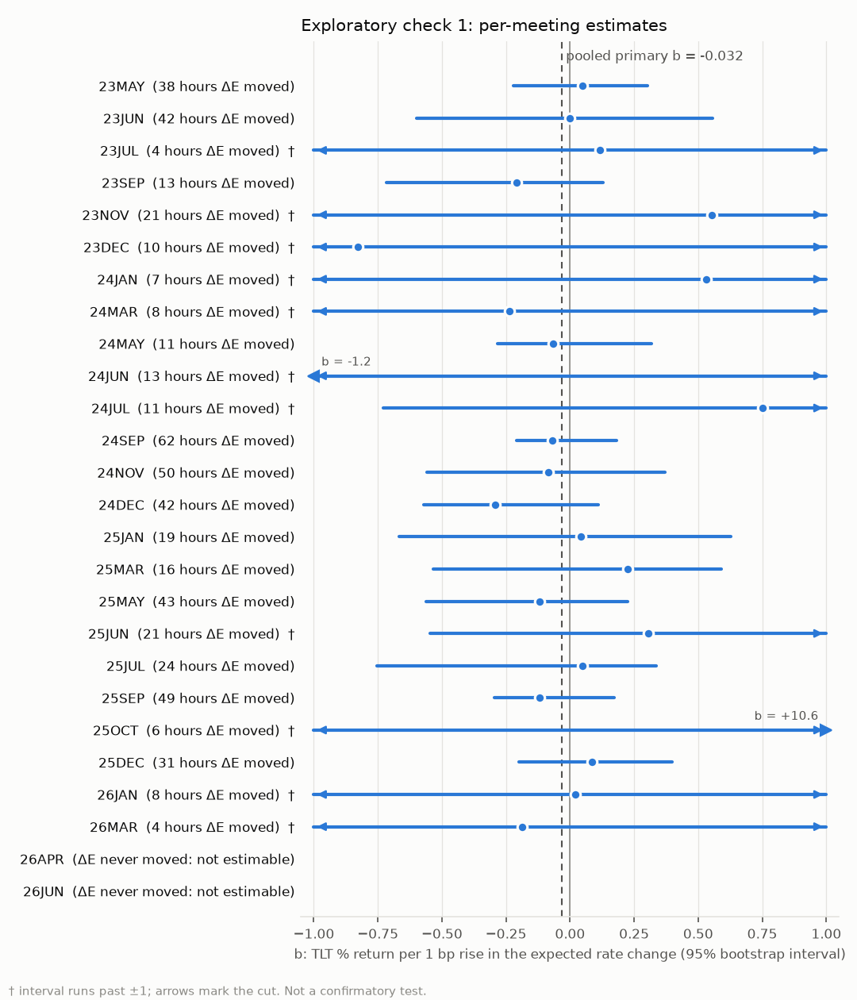

# Kalshi expected rate change and TLT across Fed meetings, May 2023 – June 2026

Written 2026-10-10. The design was fixed in advance in [PLAN.md](PLAN.md), which also records every dated deviation. Every number below is in [results/](results/). A one-page version is in [SUMMARY.md](SUMMARY.md).

This document has three parts, kept separate on purpose:

1. **Confirmatory:** the one pre-registered test and its decision rule.
2. **Exploratory:** checks the plan listed in advance. They aren't confirmatory, whatever their p-values.
3. **Post-hoc:** diagnostics added after the primary result was seen. They aren't in the plan and they aren't tests of the hypothesis.

## Question

Across past Fed meetings, when the Kalshi market-implied expected rate change for the upcoming meeting rises, does TLT fall beyond what SPY explains?

This is an out-of-sample follow-up to fed-oct, an earlier study of mine that isn't in this repo. It found that TLT rose with Kalshi's October 2026 hold probability in hourly data from Jul 8 to Oct 5, 2026, a pre-registered finding that was fragile under a better-calibrated test. None of its hours are in this study's primary sample.

## What was fixed, and when

Each step was committed before the next one started.

| Commit | Date | What it fixed | Data seen by then |
|---|---|---|---|
| `676211d` | 2026-10-09 | The plan: sample, E(t) rules, window, model, bootstrap, decision rule, exploratory list | none |
| `95d462b` | 2026-10-09 | Metadata audit: event matching and outcome mapping, with three deviations the user approved | market titles and times only, no prices |
| `66140d0` | 2026-10-09 | Kalshi E(t) and its diagnostics | Kalshi quotes |
| `e60121d` | 2026-10-10 | A priori power for the hourly design | Kalshi only |
| `bcb5243` | 2026-10-10 | A rule for choosing the hourly or the daily design as primary | Kalshi only |
| `61ac0d0` | 2026-10-10 | The rule's outcome: **hourly stays primary** | Kalshi only |
| `c12713d` | 2026-10-10 | Stock bars fetched; analysis script committed before it was run | stock bars, no results |
| `31b7f44` | 2026-10-10 | **Primary result** | — |
| `8419daa` | 2026-10-10 | Exploratory checks 1–9 | — |

## Data

**Kalshi (regressor).**
- Hourly candles for every outcome of the 26 meetings' events, read from the EventLens store with the read-only `eventlens_app` role.
- Events before December 2024 are named `FEDDECISION-…`. Each meeting's event was matched as the one whose markets close on the decision date.
- Outcomes were mapped to basis points as follows:
  - hold → 0;
  - cut or hike 25 → ∓25;
  - hike 50 → +50;
  - legacy "Cut/Hike >25bps" → ∓50;
  - "Hike >50bps" → +75.
- Three irregular ticker suffixes (`23DEC-C24`, `23MAY-TC25`, `23MAY-TH50`) were mapped by their settlement text, with the user's approval before any candles were read ([PLAN.md, Deviations](PLAN.md#deviations)).

**Expected rate change E(t).**
- E(t) = Σ pᵢ·bpᵢ / Σ pᵢ at each top-of-hour mark.
- Each pᵢ is the YES bid/ask midpoint. A one-sided book uses ask/2 or (bid+1)/2. An empty book counts as 0 if its last estimate was 5¢ or less.
- **Diagnostics** ([results/kalshi_diagnostics.csv](results/kalshi_diagnostics.csv)):
  - No hour was lost to collection gaps, stale quotes, or Σp outside [0.80, 1.20]. Σp ranged from 0.96 to 1.05.
  - Every market closes at 13:55 or 13:59 ET on decision day, so the 13–14 decision-day interval has no E.
- An independent SQL recomputation matched E exactly at six marks across six meetings.

**Stocks (outcome and control).**
- TLT and SPY 30-minute bars from Twelve Data, one request per symbol per meeting, plus daily bars for the daily check.
- 56 credits; every request succeeded on its first try.
- Every file matches the NYSE calendar with no missing bars.
- The bars are gitignored. [data/README.md](data/README.md) lists their hashes.

**Sample.**
- Each meeting's window is the 10 NYSE sessions before the decision day, plus the decision day up to 14:00 ET.
- Hourly intervals run within a session only, from 10:00 to 16:00.
- **1,635 intervals in 286 sessions across 26 meetings.** ΔE is nonzero in 553 of them.
- ΔE never moved in two meetings' windows, April and June 2026, because their books sat on the same 1¢ quotes throughout.

## Method (confirmatory)

The model is a pooled OLS:

`r_TLT,t = a + β·r_SPY,t + b·ΔE_t + e_t`

- Returns are simple returns in %. ΔE is in bp.
- **Statistic:** the t of b̂ with CR1 standard errors clustered by trading session.
- **p-value:** a wild cluster restricted bootstrap. The null is imposed, with one Webb six-point weight per session, 9,999 draws, seed 20261009. The test is two-sided.
- **Interval:** found by inverting the same test.
- **Prediction:** b < 0.
- **Decision rule (PLAN.md):**
  - p < 0.05 and b̂ < 0 → **Supported**.
  - p < 0.05 and b̂ > 0 → **Opposite sign**.
  - p ≥ 0.05 → **Not detected**. That isn't evidence of no effect. The writeup may call effects of the minimum detectable size unlikely only if the 95% interval excludes −MDE. Otherwise the result is inconclusive.
- **Checks on the inference code** ([check_inference.py](check_inference.py)):
  - CR1 matches statsmodels.
  - Each closed-form bootstrap t matches a brute-force refit.
  - A planted effect is recovered.
  - With no effect, the test rejects 4.6% of the time.

## Power (a priori; committed before any stock data)

Simulated on the real ΔE series and sessions, with heavy-tailed, heteroskedastic noise ([power.py](power.py)):

| | Hourly (primary) | Daily close-to-close |
|---|---|---|
| False-positive rate with no effect, two-sided | 5.5% | 5.2% |
| MDE at 80% power (residual sd per bp) | 0.538 | 0.281 |
| MDE as TLT % per 25 bp, at hourly σ = 0.20 / 0.30 / 0.40% | **2.7 / 4.0 / 5.4** | 4.4 / 6.6 / 8.8 |

The pre-committed rule would have made the daily test primary if its MDE was at most two-thirds of the hourly one. Instead the daily MDE was 1.63 times the hourly one. Even with no variance outside trading hours it would be 1.33 times, so the hourly test stayed primary.

## Primary result (confirmatory)

| | |
|---|---|
| **b̂** (TLT % per 1 bp rise in the expected rate change) | **−0.032** |
| **95% interval** | **[−0.152, +0.007]** |
| **p** (two-sided, wild cluster bootstrap) | **0.178** |
| TLT move implied for a 25 bp repricing | −0.79% |
| CR1 t | −1.21 |
| β on SPY, R² | −0.007, 0.002 |
| Residual sd | 0.20% per hour |
| MDE at that sd | 0.108 % per bp (2.7% per 25 bp) |
| n | 1,635 intervals, 286 sessions, 26 meetings; ΔE nonzero in 553 |

**Decision under the pre-registered rule: Not detected, and inconclusive.**
- p = 0.178 ≥ 0.05.
- The 95% interval [−0.152, +0.007] doesn't exclude −MDE (−0.108).
- So the data neither show the predicted effect nor rule out effects of the size the study could detect.
- The estimate has the predicted sign.

> **Post-hoc caveat on fragility.** This wasn't in the plan; it was found after the result was seen. Details are under [Post-hoc diagnostics](#post-hoc-diagnostics-added-after-the-primary-result-not-in-the-plan).
> - The estimate rests on a few hours. One interval, May 31, 2023 13:00–14:00 (ΔE −8.4 bp), holds 46% of all ΔE variation, and the top 5 intervals hold 70%.
> - In the bootstrap, one session (Sept 6, 2024) supplies 40% of the null-imposed score, and the top 10 supply 90%.
> - So the bootstrap distribution is narrow: its critical |t| at b = 0 is 1.53, where a normal distribution gives 1.96. That's also why the interval is lopsided.
> - Leaving out any one of those 10 sessions keeps b̂ between −0.021 and −0.067, with p between 0.11 and 0.29. Leaving out all 10 gives −0.040, p 0.20.
> - Read the p-value and interval as fragile. The decision itself didn't change in any of these runs.

## Exploratory checks (pre-registered, not confirmatory)

[results/exploratory.csv](results/exploratory.csv) holds all 40 exploratory tests. Each uses the same bootstrap, and each subsample is fitted with its own β. One of the 40 has p < 0.05, about what chance alone would produce.

| Check | n | b̂ | 95% interval | p |
|---|---|---|---|---|
| 2 By year: 2023 | 378 | −0.011 | [−0.458, +0.458] | 0.72 |
| 2 By year: 2024 | 504 | −0.060 | [−0.192, +0.025] | 0.31 |
| 2 By year: 2025 | 501 | −0.033 | [−0.190, +0.127] | 0.67 |
| 2 By year: 2026 (ΔE moved in 12 hours) | 252 | −0.063 | [−0.964, +0.580] | 0.74 |
| 3 Excluding decision days | 1,557 | −0.033 | [−0.166, +0.006] | 0.17 |
| 4 Daily close-to-close | 260 | −0.071 | [−0.187, +0.052] | 0.22 |
| 4 Daily, clustered by meeting | 260 | −0.071 | [−0.358, +0.102] | 0.19 |
| 4 Daily by year: 2023 / 2024 / 2025 / 2026 | 60 / 80 / 80 / 40 | −0.109 / +0.025 / −0.318 / −0.504 | — | 0.40 / 0.72 / **0.044** / 0.24 |
| 5 Primary, clustered by meeting (26) | 1,635 | −0.032 | [−0.135, +0.079] | 0.077 |
| 6 Open-ended outcomes at ∓(X+50) | 1,635 | −0.023 | [−0.085, +0.009] | 0.25 |
| 7 Liquid books only | 1,386 | −0.048 | [−0.182, +0.020] | 0.25 |
| 8 Add July 2026 (27 meetings) | 1,698 | −0.033 | [−0.139, +0.005] | 0.13 |
| 9 5-session window | 858 | −0.021 | [−0.250, +0.107] | 0.65 |

**Check 1, per meeting** ([figures/per_meeting.png](figures/per_meeting.png)):
- 24 of 26 meetings are estimable. In the other two, ΔE never moved.
- 12 of the 24 estimates are negative, and none has p < 0.05.
- Meetings where ΔE moved in only a few hours have intervals too wide to say anything.

**Reading the exploratory checks:**
- Every pooled variant is negative, with p between 0.08 and 0.65.
- The variants reuse the primary test's data: the same meetings, intervals and E series, cut or reweighted differently. Their consistent negative sign is therefore not independent confirmation. It mostly shows that no single choice of specification is driving the estimate.
- The lone p < 0.05, daily 2025, is one subsample out of 40 tests and shouldn't be given weight.

## Post-hoc diagnostics (added after the primary result; not in the plan)

These were requested after the primary result was seen. They describe the data the result rests on. They don't test the hypothesis, and they don't change the decision.

### 1. Leaving out the most influential sessions

- **"Influential"** means a session's share of the bootstrap's null-imposed score: Σ over the session's hours of aᵢ·uᵢ, squared. The ranking was fixed before these reruns.
- **DFBETA** is b̂ without the session minus b̂ with it.
- **Code and results:** [posthoc.py](posthoc.py), [results/posthoc_influence.csv](results/posthoc_influence.csv).

| Left out | Meeting | Share of score | b̂ | 95% interval | p | DFBETA |
|---|---|---|---|---|---|---|
| none (primary) | | | −0.032 | [−0.152, +0.007] | 0.178 | |
| 2024-09-06 | 24SEP | 40.1% | −0.021 | [−0.145, +0.011] | 0.294 | +0.011 |
| 2024-09-04 | 24SEP | 16.9% | −0.025 | [−0.145, +0.011] | 0.270 | +0.007 |
| 2023-05-02 | 23MAY | 9.8% | −0.026 | [−0.138, +0.010] | 0.250 | +0.006 |
| 2023-06-07 | 23JUN | 9.0% | −0.026 | [−0.140, +0.009] | 0.245 | +0.006 |
| 2024-09-12 | 24SEP | 4.8% | −0.043 | [−0.170, +0.003] | 0.110 | −0.011 |
| 2023-10-19 | 23NOV | 3.1% | −0.035 | [−0.161, +0.005] | 0.141 | −0.004 |
| 2025-09-03 | 25SEP | 2.2% | −0.029 | [−0.148, +0.009] | 0.203 | +0.003 |
| 2023-05-31 | 23JUN | 1.7% | −0.067 | [−0.170, +0.012] | 0.129 | −0.035 |
| 2025-07-16 | 25JUL | 1.0% | −0.034 | [−0.159, +0.006] | 0.151 | −0.002 |
| 2024-09-10 | 24SEP | 0.9% | −0.030 | [−0.150, +0.008] | 0.197 | +0.002 |
| **all 10 together** | | 89.6% | **−0.040** | **[−0.107, +0.021]** | **0.204** | |

- **Sign and decision:** no single omission flips the sign or brings p below 0.05.
- **Size of the estimate:** it does move.
  - The May 31, 2023 session holds the largest single ΔE move. It's ranked only 8th by score share, but dropping it doubles b̂ to −0.067.
  - Dropping any one of the top four sessions by score share shrinks b̂ to between −0.021 and −0.026.
- **Score share and influence on b̂ are different things.** Dropping all 10 leaves b̂ about where it was, with a narrower and more symmetric interval.

### 2. News in the influential hours

For each of the 10 sessions, the hour that contributes most to its score ([results/posthoc_hours.csv](results/posthoc_hours.csv)), plus the largest single ΔE hour. Times are ET. ΔE > 0 means the market expected a higher rate.

| Session, hour | ΔE (bp) | What happened then | Direction consistent? | Sources |
|---|---|---|---|---|
| 2023-05-31, 10–11 | +1.89 | April JOLTS at 10:00: openings rose to 10.1 million, read as a hot labor market before the June meeting | yes (hawkish) | [BLS](https://www.bls.gov/news.release/archives/jolts_05312023.htm), [KUTV](https://kutv.com/news/nation-world/aprils-job-openings-defy-expectations-spiking-above-10-million-robust-labor-market-economic-outlook-target-costco-home-depot-retail-sector-slow-economy-high-inflation) |
| 2023-05-31, 13–14 (largest ΔE in the sample) | −8.38 | Governor Jefferson said skipping a hike in June would let the Fed see more data, and Harker backed a skip. Futures cut June-hike odds from about two in three to one in three. A Reuters wire on the reaction is stamped 17:57 GMT (13:57 ET) | yes (dovish) | [Reuters via CNBC Africa](https://www.cnbcafrica.com/wire/418968), [AP via News4Jax](https://www.news4jax.com/business/2023/05/31/federal-reserve-likely-to-skip-interest-rate-hike-at-next-meeting-in-june-officials-signal/), [Investing.com](https://investing.com/news/economy/us-rate-futures-expect-fed-pause-in-june-in-sharp-turnaround-from-earlier-3095471) |
| 2024-09-06, 12–13 | +1.13 | No single release. After the 8:30 payrolls report and Waller's "open-minded" remarks, half-point-cut bets unwound: Briefing.com's 1:00 pm update had 50 bp odds at 23%, against 40% the day before | yes (fewer cuts priced) | [Bloomberg](https://www.bloomberg.com/news/articles/2024-09-06/fed-s-waller-says-jobs-data-requires-action-open-to-big-cut), [Briefing.com](https://briefing.com/bond-market-update/archive/2024/9/6/gains-narrowed) |
| 2024-09-04, 10–11 | −2.39 | July JOLTS at 10:00: openings fell to 7.67 million, below every forecast and the lowest since January 2021 | yes (dovish) | [Bloomberg](https://www.bloomberg.com/news/articles/2024-09-04/us-job-openings-decline-to-lowest-level-since-january-2021), [investingLive](https://investinglive.com/news/jolts-job-openings-7673m-vs-8100m-estimate-20240904/amp) |
| 2023-05-02, 10–11 | −0.74 | March JOLTS at 10:00: openings fell to 9.59 million, below forecasts | yes (dovish) | [BLS](https://www.bls.gov/news.release/archives/jolts_05022023.htm), [Bloomberg](https://www.bloomberg.com/news/articles/2023-05-02/us-job-openings-fall-by-more-than-forecast-to-9-59-million) |
| 2023-06-07, 10–11 | +1.18 | The Bank of Canada unexpectedly hiked to 4.75% at 10:00, ending a four-month pause | yes (hawkish) | [Huddle](https://huddle.today/2023/06/07/bank-of-canada-hikes-key-interest-rate-to-4-75-percent/), [blogTO](https://blogto.com/city/2023/06/bank-canada-june-interest-rate-hike) |
| 2024-09-12, 13–14 | −4.43 | **Not identified with confidence.** The WSJ (Timiraos) report that revived bets on a 50 bp cut is dated around Sept 12–13, but I couldn't confirm that it landed in this hour | — | [Investing.com](https://investing.com/news/economy/bets-on-50-bps-fed-rate-cut-in-september-bounce-back-strongly-3615298), [Nasdaq](https://www.nasdaq.com/articles/put-your-money-50-basis-points) |
| 2023-10-19, 12–13 | −0.61 | Powell spoke at the Economic Club of New York at noon. His remarks were read as neutral, and as suggesting the Fed might not need to hike again | yes (dovish) | [CNBC](https://www.cnbc.com/amp/2023/10/19/watch-fed-chair-jerome-powell-deliver-a-speech-on-the-us-economy.html), [FRASER transcript](https://fraser.stlouisfed.org/title/statements-speeches-jerome-h-powell-1164/opening-remarks-economic-club-new-york-luncheon-new-york-new-york-657519) |
| 2025-09-03, 10–11 | −1.09 | July JOLTS at 10:00: openings fell to 7.18 million, below the expected 7.4 million | yes (dovish) | [BLS](https://www.bls.gov/news.release/archives/jolts_09032025.htm), [Calculated Risk](https://www.calculatedriskblog.com/2025/09/bls-job-openings-decreased-to-72.html) |
| 2025-07-16, 11–12 | −0.74 | Late-morning reports that Trump was likely to fire Powell; he later called it "highly unlikely." Short-term Treasuries rallied on talk of a successor | yes (dovish) | [Bloomberg](https://www.bloomberg.com/news/articles/2025-07-16/markets-rattled-by-credible-threat-trump-tries-to-fire-powell), [ABC7](https://abc7.com/post/jerome-powell-trump-says-hes-highly-fire-feds-floating-idea-private/17150224/) |
| 2024-09-10, 15–16 | +0.56 | **No news found** | — | — |

**What this shows:**
- Nine of the eleven hours line up with a scheduled release (four JOLTS reports at 10:00, the Bank of Canada at 10:00) or a known event (Jefferson, Powell, the Powell-firing reports, the post-Waller unwinding).
- In each of those nine hours, ΔE moved in the direction the news would imply. That supports E(t) as a measure of expectations.
- Most of the identified moves are scheduled data or Fed speakers. The FOMC blackout covers most of each window, but releases and outside news still arrive during it.
- None of this is evidence about the TLT link itself. It only says where the information in the regressor comes from.

## Interpretation

- **Against fed-oct.** fed-oct found TLT up about 19 bp per 10-point rise in the October hold probability, with the hike market taking the other side. As a rough conversion, that's about −0.09 % per bp of expected rate change. That value lies inside this study's interval. The out-of-sample estimate is smaller (−0.032) and not significant. This study therefore neither confirms nor rules out an effect of fed-oct's size.
- **Size.** The point estimate, −0.8% on TLT per 25 bp repricing, is the size you'd get if long yields moved a few bp per 25 bp of front-end repricing. That's a rough benchmark, not an estimate. The design could reliably detect only about 2.7% or more.
- **Why power is low.**
  - Within trading hours, ΔE moves by about 0.3 bp an hour.
  - Its largest moves cluster at 10:00 data releases and Fed speeches.
  - The 8:30 releases fall outside the hourly design.
  - The daily design captures those, but has too few observations to do better.

## Limitations

- **Power.** The minimum detectable effect (0.108 % per bp) is about 3.4 times this study's own estimate (0.032). If the true effect is near the estimate, a non-detection was the likely outcome.
- **Concentration.** A few hours carry most of the information, which makes the bootstrap distribution and the interval irregular (see the post-hoc caveat).
- **Construction of ΔE.**
  - Tail outcomes are often quoted on one side only: 4,808 of 9,605 outcome-marks (50%) used rule 2 (p = ask/2).
  - Legacy open-ended outcomes need an assumed bp value. Exploratory check 6 tests that choice.
  - Kalshi's 1¢ tick leaves near-certain meetings flat. ΔE never moved in April or June 2026.
- **Controlling for SPY.** If rate news moves SPY too, controlling for SPY removes part of the effect being studied. Here SPY explains almost nothing of TLT's hourly moves (R² 0.002), so this matters little.
- **Correlation, not causation.** News can move both series at once. This isn't a forecast or a trading signal.

## Deviations from the plan

All are dated in [PLAN.md](PLAN.md#deviations) and were logged before the data they affect was read:

1. **Event tickers.** Pre-2024 events are named `FEDDECISION-…`. The matching rule was unchanged.
2. **Three irregular ticker suffixes.** Mapped by settlement text, with the user's approval.
3. **Hold labels.** All four wordings mapped to 0 bp.
4. **No decision-day 13–14 interval.** Markets close at 13:55 or 13:59, so this hour has no E. That follows from the plan's own rule.
5. **The hourly-or-daily rule.** Pre-committed and applied; the hourly test stayed primary.

## Next steps

- **More power.** The test needs more information per hour or more meetings.
  - One option is a 1-minute or 5-minute design around scheduled 10:00 releases. Kalshi minute candles exist, though the store doesn't hold them yet.
  - Another is Treasury futures, which trade through the 8:30 releases.
- **Replication.** fed-oct's TLT finding is still unreplicated. The cleanest test is a pre-registered single-meeting design on a meeting with a contested outcome.

*Code: [kalshi.py](kalshi.py) (E(t)), [meetings.py](meetings.py) (windows), [fetch_stocks.py](fetch_stocks.py), [inference.py](inference.py) (the bootstrap), [power.py](power.py), [analysis.py](analysis.py), [posthoc.py](posthoc.py).*
